# hazelhidayah.github.io

<picture>
  <source media="(prefers-color-scheme: dark)" srcset="./dark.svg">
  <source media="(prefers-color-scheme: light)" srcset="./light.svg">
  
</picture>

Personal portfolio for my software, product design, and creative work.

[Visit the portfolio](https://hazelhidayah.github.io)

## Preview locally

```sh
bundle install
bundle exec jekyll serve --livereload
```

Open `http://127.0.0.1:4000` in your browser. Stop the server with `Ctrl+C`.

<!-- Repository for Hazel's Jekyll-powered GitHub Pages site. -->
